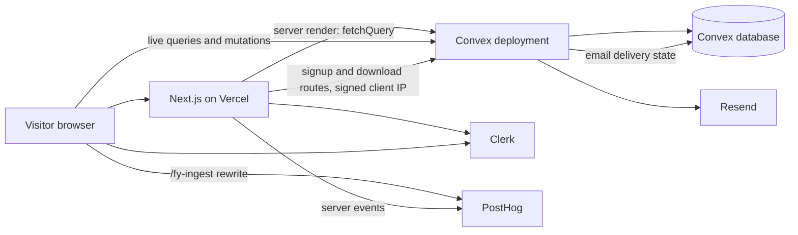

# Foleyard

Foleyard is a local-first browser for messy SFX folders, music cues, and large
audio libraries. This repository is the **marketing site**: the landing page,
waitlist and download signup, the blog, the CMS-backed pages, and the admin
panels that drive them. The desktop app itself lives elsewhere — download links
point at GitHub releases of [`Daelars/foleyard-v2`](https://github.com/Daelars/foleyard-v2).

## Stack

| Layer     | Choice                                                              |
| --------- | ------------------------------------------------------------------- |
| Framework | Next.js 16 (App Router, React Compiler), React 19, TypeScript        |
| Styling   | Tailwind CSS v4 with the typography plugin                           |
| Backend   | Convex — database, queries/mutations, HTTP endpoints, cron jobs      |
| Auth      | Clerk — sign-in plus a `role` claim that gates admin pages           |
| Email     | Resend — waitlist thank-you, download link, one-time launch email    |
| Analytics | PostHog — browser events proxied through `/fy-ingest`, server events |
| Hosting   | Vercel for the Next.js app, Convex Cloud for the backend             |

`bun` is the only package manager: `bun.lock` is the only lockfile and
`package.json` pins `bun@1.3.13`. `package-lock.json` is deleted and ignored, so
do not add `package-lock.json`, `yarn.lock`, or `pnpm-lock.yaml`.

## How the pieces fit



- **Server-rendered pages** (`app/blog`, `app/blog/[slug]`, `app/about`, …) read
  Convex with `fetchQuery` from `convex/nextjs` and render on the server.
- **Client components** that need live data (`components/waitlist-form.tsx`,
  the admin clients) use `ConvexProviderWithClerk`, so queries update in real
  time and admin mutations carry the Clerk token.
- **Public forms never call Convex directly.** The browser posts JSON to a Next
  route (`/api/waitlist`, `/api/download-signup`, and `/api/download` for the
  download count), which validates its input and forwards to the Convex HTTP
  endpoint at `NEXT_PUBLIC_CONVEX_SITE_URL`. The Next hop adds the visitor's
  address in `x-foleyard-client-ip` together with `FOLEYARD_CLIENT_IP_SECRET` in
  `x-foleyard-client-ip-secret`; Convex only trusts the forwarded address when
  the secret matches, so rate limits apply per visitor and direct callers
  cannot spoof a new bucket (`lib/client-ip.ts`, `convex/http.ts`).
- **Analytics** requests are rewritten from `/fy-ingest/*` to PostHog in
  `next.config.ts`, so the browser talks to the site's own origin.

### Convex tables

| Table                 | Holds                                                             |
| --------------------- | ----------------------------------------------------------------- |
| `waitlistSignups`     | pre-launch signups, thank-you delivery state, per-recipient launch email state, hashed IP |
| `downloadSignups`     | post-launch "email me the link" signups                           |
| `waitlistRateLimits`  | per-IP and per-email rate limit counters; a daily cron clears the backlog in batches |
| `blogPosts`           | blog posts (markdown, slug, tags, cover image, published date)    |
| `sitePages`           | editable copy for about / founder / founders / team / contact      |
| `teamMembers`         | team list shown on `/team`                                        |
| `launchConfig`        | waitlist-vs-download switch and the launch-email claim            |
| `launchEmailProgress` | cursor, counts and lease of the batched launch email send         |
| `downloads`           | download rows, one per hashed visitor per hour                    |
| `downloadStats`       | counter document (`key: "downloads"`) read by the admin total     |

## Local setup

Prerequisites: [bun](https://bun.sh), Node 20+ (required by Next.js 16 — the repo
does not pin an engines field), a Convex account, a Clerk application, and (for
email) a Resend API key.

```bash
bun install
bunx convex dev   # terminal 1
bun run dev       # terminal 2
```

`bunx convex dev` logs into Convex, creates or selects a deployment, writes
`CONVEX_DEPLOYMENT` into `.env.local`, generates `convex/_generated`, and pushes
the schema and functions. Keep it running while you work; it redeploys on save.
The app is then on <http://localhost:3000>.

Scripts (`package.json`):

| Script             | Does                                        |
| ------------------ | ------------------------------------------- |
| `bun run dev`      | `next dev` (Turbopack)                      |
| `bun run build`    | `next build`                                |
| `bun run start`    | `next start` after a build                  |
| `bun run lint`     | ESLint over the app and Convex code         |
| `bun run typecheck` | `tsc --noEmit` plus `tsc --noEmit -p convex` |
| `bun run check`    | lint plus typecheck                         |

### Checks

```bash
bun run check   # lint plus type-checking for the app and Convex functions
bun run lint
bun run typecheck
```

Every pull request runs lint, typecheck, and a production build in
[`.github/workflows/ci.yml`](.github/workflows/ci.yml).

## Environment variables

`.env.example` is tracked (`.gitignore` ignores `.env*` but re-includes
`!.env.example`). Copy it to `.env.local` and fill in the real values. It does
not list the Clerk keys, but the app needs them; see the table below.

Variables marked **Vercel** are read by the Next.js app (build or server) and
belong in the Vercel project settings plus `.env.local`. Variables marked
**Convex** are read inside Convex functions and must be set on the deployment:

```bash
bunx convex env set RESEND_API_KEY re_...
bunx convex env list
```

| Variable                            | Set on         | Purpose                                                                                                       |
| ----------------------------------- | -------------- | ------------------------------------------------------------------------------------------------------------- |
| `CONVEX_DEPLOYMENT`                 | local CLI      | Which Convex deployment the CLI talks to. Written by `convex dev`; not needed on Vercel.                       |
| `NEXT_PUBLIC_CONVEX_URL`            | Vercel         | Deployment URL (`https://<deployment>.convex.cloud`) used by the browser Convex client and server renders.     |
| `NEXT_PUBLIC_CONVEX_SITE_URL`       | Vercel         | HTTP-actions URL (`https://<deployment>.convex.site`). The signup and download routes forward here; they fail without it. |
| `NEXT_PUBLIC_SITE_URL`              | Vercel         | Canonical origin for metadata, sitemap, `robots.txt` and JSON-LD. Defaults to `https://foleyard.com`.          |
| `NEXT_PUBLIC_POSTHOG_PROJECT_TOKEN` | Vercel, Convex | PostHog project token for browser and server events. Analytics is skipped when it is missing.                 |
| `NEXT_PUBLIC_POSTHOG_HOST`          | Vercel         | PostHog API host used by the `/fy-ingest` rewrite and `ui_host`. Defaults to `https://us.i.posthog.com`.        |
| `NEXT_PUBLIC_POSTHOG_ASSETS_HOST`   | Vercel         | Optional. Assets host for the `/fy-ingest/static/*` rewrite. Defaults to `https://us-assets.i.posthog.com`.      |
| `POSTHOG_PROJECT_TOKEN`             | Vercel, Convex | Optional server-only override for the token; falls back to the `NEXT_PUBLIC_` value.                           |
| `POSTHOG_HOST`                      | Vercel, Convex | Optional server-only override for the PostHog host.                                                            |
| `RESEND_API_KEY`                    | Convex         | Sends every transactional email. Without it, sends are recorded as `failed` with a clear error.               |
| `RESEND_FROM_EMAIL`                 | Convex         | `From` address for all mail. Defaults to `hello@foleyard.com`; the domain must be verified in Resend.          |
| `WAITLIST_IP_HASH_SALT`             | Convex         | Salt for the SHA-256 hash of visitor IPs, used for waitlist signups and download visitor ids. Falls back to `CONVEX_DEPLOYMENT`, then to a constant — set it. |
| `FOLEYARD_CLIENT_IP_SECRET`         | Vercel, Convex | Long random shared secret. The Next routes send it with the forwarded address; Convex ignores the address unless it matches. Must be identical in both places. Missing on either side puts every signup in one bucket. |
| `NEXT_PUBLIC_CLERK_PUBLISHABLE_KEY` | Vercel         | Clerk publishable key, required by `ClerkProvider`. Not in `.env.example`, but the app needs it.               |
| `CLERK_SECRET_KEY`                  | Vercel         | Clerk secret key, required by `clerkMiddleware` in `proxy.ts`.                                                 |
| `CLERK_JWT_ISSUER_DOMAIN`           | Convex         | Issuer domain of the Clerk JWT template that Convex validates (`convex/auth.config.ts`).                       |

Rotating `WAITLIST_IP_HASH_SALT` changes every stored IP hash, so old and new
rate-limit records no longer match. Treat it as a long-lived secret.

## Signup and email flow

The landing page (`app/page.tsx`) renders `WaitlistForm`, which reads
`launch.get` from Convex:

1. **Before launch** it shows the waitlist form. Submitting posts
   `{ email, source, website }` to `/api/waitlist`. The Next route validates it,
   forwards it to Convex, and Convex:
   - drops the submission silently if the hidden `website` honeypot is filled,
   - applies rate limits (5 submissions per IP per 15 minutes, 2 per email per
     24 hours),
   - normalises the email, hashes the IP with `WAITLIST_IP_HASH_SALT`, and
     inserts `waitlistSignups` (or reuses the existing row for a duplicate). A
     duplicate does not send another thank-you email unless the stored delivery
     previously failed, in which case the retry is scheduled,
   - schedules the Resend thank-you email and records `sent` / `failed` plus the
     provider id or error on the signup row.
2. **After launch** (`launchConfig.launched`) it shows the download panel
   instead: a button that posts to `/api/download` (which forwards the visitor
   address to Convex, where it is hashed and recorded at most once per hour) and
   opens the latest GitHub release (via `/api/latest-release`, which falls back
   to the releases page), plus an optional "email me the link" form that follows
   the same path through `/api/download-signup` into `downloadSignups`. The
   duplicate rule is the same as on the waitlist.

Emails are sent from Convex actions in `convex/waitlistEmail.ts`,
`convex/downloadEmail.ts`, and `convex/launchEmail.ts`. When `RESEND_API_KEY`
is missing they do not skip silently: the thank-you senders record the signup's
delivery state as `failed` with a clear error, and the launch sender records a
`failed` per-recipient state.

### Launch email

`/admin/launch` sends the one-time announcement from
`convex/launchAction.ts` in batches of 25 recipients. Each recipient has a
`launchEmailState` on the signup row and the run keeps its cursor, counts and
lease in `launchEmailProgress`, so closing the tab mid-send is safe: "Resume
Sending" continues from the last batch, and "Retry Failed" only re-attempts
recipients recorded as `failed`. An attempt interrupted before delivery was
recorded becomes `unconfirmed`; it is never retried automatically, because that
could send a second copy. Resend idempotency keys (`launch/<signupId>`) back
this up. "Reset Claim" only releases a claim that sent nothing. A deployment
that sent the launch email before batch sending existed is treated as finished
and cannot be resumed or reset.

## Admin

| Route          | Manages                                                          |
| -------------- | ---------------------------------------------------------------- |
| `/admin/site`  | Page copy for about / founder / founders / team / contact, and team members |
| `/admin/blog`  | Create, edit, and delete blog posts (markdown)                    |
| `/admin/launch`| Flip the site between waitlist and download mode, see the download count, and run the batched launch email (resume, retry failures, reset an unsent claim) |

All three are `force-dynamic` server components. Signed-out visitors get a
Clerk sign-in prompt; signed-in users without the admin role get a 404.
Server-side mutations are guarded independently by `assertAdmin` in
`convex/lib/admin.ts`, which checks the Clerk identity claims for
`role: "admin"`.

**Granting admin:** in the Clerk dashboard, open the user and set public
metadata:

```json
{ "role": "admin" }
```

Then make sure the Clerk JWT template used by Convex (named `convex`) includes
that role in its claims, because the Convex check reads it from the JWT — the
public metadata alone is not enough there. `CLERK_JWT_ISSUER_DOMAIN` on the
Convex deployment must match that template, and its audience should be `convex`
(see `BLOG.md` and `convex/auth.config.ts`). `BLOG.md` also documents enabling
Google OAuth and email one-time codes in Clerk.

## Blog and CMS content

- Posts live in `blogPosts`; markdown is rendered on the server by
  `lib/markdown.ts`, which drops raw HTML and strips `javascript:` / `data:`
  links and image sources before output.
- Lists never load post bodies. `/blog` shows 9 summary cards per page with
  "Older dispatches" / "Newest first" links; `sitemap.xml` walks
  `listPostSummaries` in pages of 50 so every post still gets a URL, and
  `/admin/blog` pages 20 summaries and fetches a body only when you edit a
  post. `blog.listPostSummaries` paginates; `blog.listPosts` remains as a
  temporary deprecated export.
- Cover images and inline images are referenced as `/blog-images/<file>.png`.
  The files under `public/blog-images/` are not tracked in git yet, so a fresh
  clone renders broken images until they are added; how they are served is
  still an open decision. `BLOG.md` covers the post schema and editing flow.
- Page copy for the static marketing pages lives in `sitePages`, with fallback
  copy in `lib/site-defaults.ts`. `/admin/site` can seed the defaults.

## Deploys

- **Production** is the `foleyard-prod` Vercel project. It builds with

  ```bash
  bunx convex deploy --cmd-url-env-var-name NEXT_PUBLIC_CONVEX_URL --cmd 'bun run build'
  ```

  set in the Vercel project settings, not in this repository (there is no
  `vercel.json`). `convex deploy` pushes the schema and functions to the
  production deployment, then `next build` runs against it. The backend push is
  therefore part of every production build, not a separate manual step.
- `foleyard-prod` builds production only: an ignored build step skips its
  preview builds. Pull-request previews come from the separate `foleyard`
  Vercel project.
- Set the **Vercel** variables in `foleyard-prod` (and in `foleyard` for
  previews) and the **Convex** variables on the production deployment.
  `FOLEYARD_CLIENT_IP_SECRET` must be the same value on both sides.
- A change that touches `convex/schema.ts` ships schema and functions first,
  because `bunx convex deploy` runs before `bun run build` in the build command.
  For local schema pushes, use `bunx convex dev --once`.
- After the production deploy that first adds `downloadStats`, run the one-time
  counter backfill:

  ```bash
  npx convex run --prod downloads:backfillCount
  ```

  Until the counter exists, the admin download total falls back to a scan
  capped at 1000 rows rather than the real figure. The command is safe to
  re-run; the counter never moves backwards.

## Repository layout

```
app/                 routes: landing, blog, marketing pages, admin, API routes
components/          UI and client components (forms, admin clients, navbar)
convex/              schema, queries/mutations, HTTP endpoints, cron, emails
convex/_generated/   generated by `convex dev` — do not edit
lib/                 shared schemas (Zod), markdown renderer, SEO, admin checks
public/              static assets, including blog images
proxy.ts             Clerk middleware
next.config.ts       React Compiler, Turbopack root, PostHog rewrites
eslint.config.mjs    ESLint flat config (Next core-web-vitals and TypeScript)
.github/workflows/   CI: install, lint, typecheck, production build
BLOG.md              blog + CMS notes
```

## Conventions

Commits follow Conventional Commits (`feat:`, `fix:`, `docs:`, …). Keep the
generated Convex files out of hand edits and run `bun run check` before opening
a PR; CI runs the same lint, typecheck, and build.
